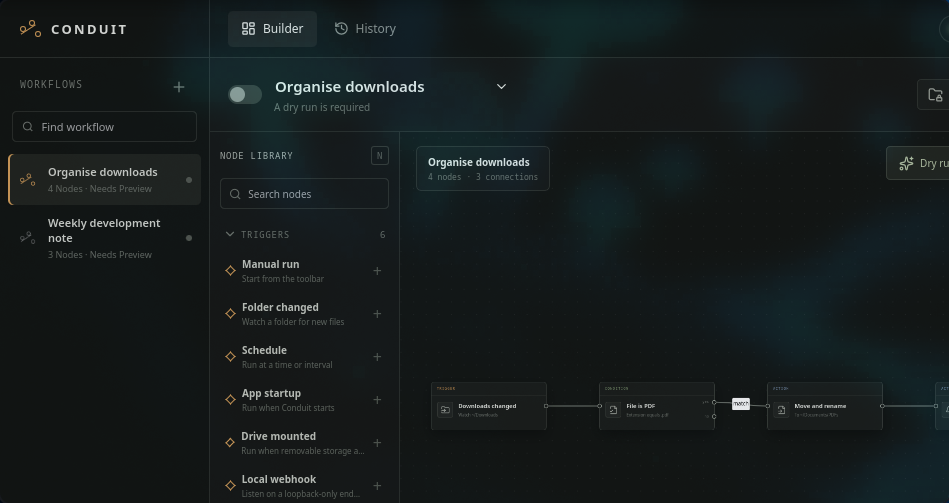

# Conduit

Conduit is a local-first desktop app for building understandable automations from triggers, conditions, and actions on a visual canvas.



The project now covers the original release stages and advanced-node roadmap:

- visual workflow editor with typed trigger, condition, and action nodes;
- connection validation and cycle prevention;
- editable node configuration and per-workflow folder permissions;
- dry-run plans with exact sources, destinations, warnings, and file limits;
- preview approval required again after a workflow changes;
- collision-safe copy and move actions with overwriting disabled;
- local SQLite run history in the Tauri app;
- browser-local fallback for UI development;
- workflow and history import/export;
- durable enabled-workflow state and preview approvals;
- native folder watching with periodic reconciliation for missed events;
- five-field cron schedules and application-startup triggers;
- bounded retries, duplicate-file suppression, and single-run concurrency;
- crash recovery that records interrupted runs as failed rather than assuming success;
- a system-tray process that keeps enabled workflows alive after the window closes;
- live engine health, watcher counts, and runtime state in the interface;
- drive-mounted and loopback webhook triggers;
- desktop notifications and honest, journalled Undo;
- safe ZIP creation/extraction and desktop-trash actions;
- completed-download detection plus console-aware ROM extraction—including Wii U disc images, archives, multipart RAR sets, and settled loose `code/content/meta` game directories—into `~/Programs/Roms`, direct PS4 `.pkg` routing into `~/Programs/PS4`, and safe ZIP/7z/RAR5 package extraction into that same folder, with start and completion notifications for long extractions;
- label-and-UUID matched PS4USB synchronization that copies the ROM directory tree, atomically moves verified `.pkg` files to the SSD root, announces transfer start and completion, and automatically retries an insufficient-space sync after files are deleted from the still-mounted drive;
- HTTPS requests with OS-keyring bearer secrets, timeouts, redirect limits, and response limits;
- FFmpeg conversion, Git summaries, Tesseract OCR, and ExifTool metadata nodes;
- user-defined manual-run form values;
- content-aware download routing by signature, extension, filename, and bounded document content;
- a constrained KMail Cleanup integration with scheduled preview and manual-only reviewed apply;
- durable schedule claims and optional catch-up windows after downtime;
- importable templates for downloads, KMail, screenshot filing, OCR, Git notes, webhooks, and phone-photo imports;
- Linux, Windows, and macOS release configuration with draft GitHub releases.

Optional executable nodes are capability-checked. A missing program produces a visible failed run instead of silently skipping the node.

## Run the interface

```bash
npm install
npm run dev
```

The browser version uses safe simulated runs, which makes UI work possible without filesystem access.

## Run the desktop app on Fedora

Install Tauri's native Linux prerequisites once:

```bash
sudo dnf install webkit2gtk4.1-devel libsoup3-devel libappindicator-gtk3-devel
```

Then start Conduit:

```bash
npm run desktop
```

Optional nodes use standard desktop tools when installed:

```bash
sudo dnf install ffmpeg git tesseract perl-Image-ExifTool
```

Build RPM and AppImage packages with:

```bash
npm run desktop:build
```

## Safety contract

Conduit expands and resolves every filesystem path in the Rust process. A resolved source or destination must be within one of the workflow's explicit folder permissions. Filesystem runs are rejected unless the exact workflow definition has completed a dry run. Approval is stored by a SHA-256 signature; any material edit revokes it and disables the workflow. File discovery is bounded, execution is serialized, retries are capped at three, and destination collisions receive a numeric suffix instead of overwriting data.

Run data, enabled workflow definitions, approvals, and processed-file fingerprints live in the platform application-data directory as `conduit.sqlite3`. Workflow drafts also stay local in the webview's local storage. Closing the window hides Conduit to the system tray; use **Quit Conduit** from the tray menu to stop the background engine.

Pass `--background` to start the scheduler and tray icon without opening the main window. A second normal launch focuses the already-running instance instead of creating a duplicate worker. On Linux, this mode can be used from an XDG login entry such as `~/.config/autostart/conduit.desktop`.

Schedules use the standard five fields `minute hour day-of-month month weekday`. For example, `0 17 * * 5` runs Friday at 17:00 in the computer's local timezone.

Local webhooks bind only to `127.0.0.1`. For the bundled template:

```bash
curl -X POST http://127.0.0.1:43821/conduit --data 'A local automation note'
```

HTTP bearer secrets are stored through the settings button in the operating-system keyring. Workflow files contain only the secret name.

Import ready-made workflows from [`templates/`](templates). Security decisions and recovery procedures are documented in [`docs/THREAT_MODEL.md`](docs/THREAT_MODEL.md) and [`docs/RECOVERY.md`](docs/RECOVERY.md).
The built-in desktop automations and their one-time activation steps are documented in [`docs/AUTOMATIONS.md`](docs/AUTOMATIONS.md).

## Checks

```bash
npm run build
cargo test --manifest-path src-tauri/Cargo.toml
```

The Rust check needs the native Fedora packages listed above.
